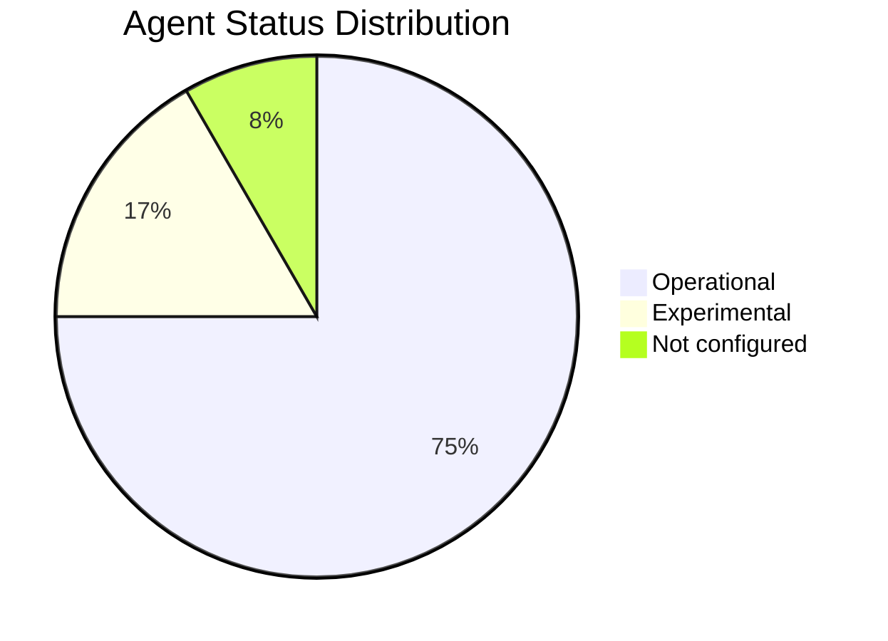
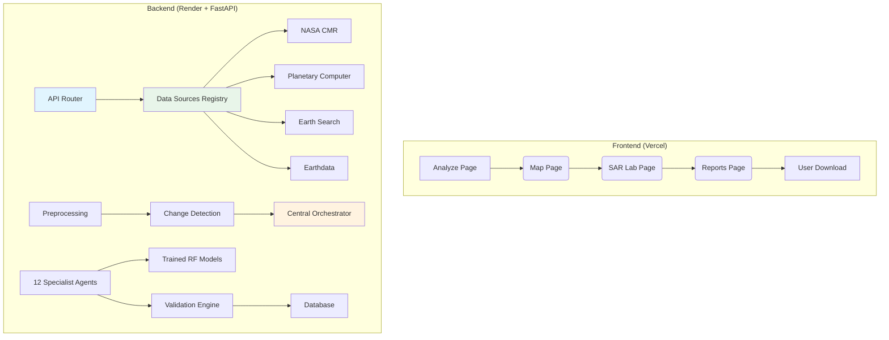
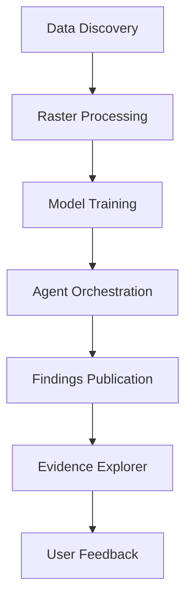
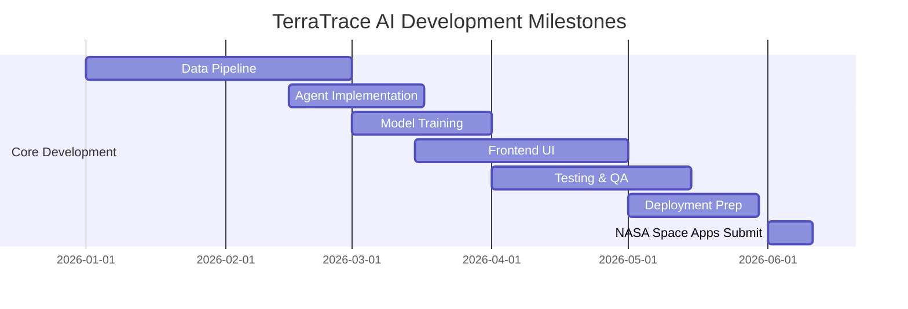

# 🛰️ TerraTrace AI 2.0 — Multi-Sensor SAR Earth Observation & Environmental Intelligence Platform

[](https://terratrace-g6ipjfbgp-nishantkhargas-projects.vercel.app)
[](https://terratrace-ai-backend.onrender.com/api/health)
[](https://terratrace-g6ipjfbgp-nishantkhargas-projects.vercel.app)
[](https://github.com/NISHANTKHARGA/terratrace-ai)
[](LICENSE)

---

## 🌍 Mission

TerraTrace AI is a professional multi-sensor Synthetic Aperture Radar (SAR) Earth observation platform that discovers real satellite observations, runs scientific change detection, and publishes evidence-backed environmental findings via 12 specialized AI agents. Built for the **NASA Space Apps Challenge**, it demonstrates actual satellite data processing, machine learning model training, and geospatial intelligence — not simulated data or placeholder cards.

> **Core Principle:** DO NOT just show the user that AI detected something. SHOW the user what the satellite actually observed, how the change was measured, why the AI reached its conclusion, and how reliable that conclusion is.

---

## 📡 Real NASA & International Space Agency Data Sources

TerraTrace AI acquires real satellite observations from official repositories:

| Data Source | Mission | Status | Access |
|---|---|---|---|
| **NASA CMR** | NISAR, OPERA, Sentinel-1, UAVSAR | ✅ Operational | Anonymous metadata discovery |
| **Microsoft Planetary Computer** | Sentinel-1 RTC (10 m resolution) | ✅ Operational | Anonymous SAS-signed COG access |
| **AWS Earth Search** | Sentinel-1 GRD, Sentinel-2 L2A, Copernicus DEM GLO-30 | ✅ Operational | Anonymous STAC catalogue |
| **NASA UAVSAR** | Airbourne L-band SAR (RPI/POLSAR) | ✅ Discovered | Open data, browse accessible |
| **NASA GIBS** | MODIS True-Color (live basemap) | ✅ Live | Anonymous WMTS tiles |
| **Copernicus DEM** | GLO-30 (terrain context) | ✅ Available | Earth Search STAC items |

### Key Data Products Used

| Product | Polarization | Resolution | Purpose |
|---|---|---|---|
| Sentinel-1 RTC | VV, VH | ~10 m | Primary SAR backscatter for change detection |
| Sentinel-1 GRD | VV, VH | ~5 m | Graded radar geometry (metadata/browse) |
| NISAR | RSLC, GSLC, GCOV | L-band | Future: L-band penetrate vegetation |
| OPERA | RTC-S1, DSWx-S1 | C-band | Future: Displacement & water products |
| UAVSAR | RPI, POLSAR | L-band | Future: Interferometric deformation |
| MODIS | True-color | 500 m | Live basemap (GIBS) |
| Copernicus DEM | GLO-30 | 30 m | Terrain slope/context for agents |

> **Data Honesty:** TerraTrace never fabricates satellite imagery. If data is unavailable, the system reports the actual limitation (e.g., "requires_credentials", "metadata-only", "georeferencing missing").

---

## 🤖 The 12 Specialist Agents

TerraTrace AI runs **12 specialized environmental analysis agents** automatically when an analysis is triggered. Each agent has its own analytical responsibility, trained models, evidence requirements, and structured results.

### Agent Status Overview



### Agent Capabilities Table

| # | Agent | Status | Model | Core Capability |
|---|---|---|---|---|
| **1** | **Flood & Inundation Intelligence** | ✅ Operational | RandomForest (VV dB) | Water segmentation, before/after inundation, confidence scoring |
| **2** | **Wetlands & Water Bodies Intelligence** | ✅ Operational | RandomForest (VV dB) | Permanent/seasonal water signatures, wetland boundary changes |
| **3** | **Forest & Deforestation Intelligence** | ✅ Operational | RandomForest | Vegetation-associated radar signature changes, temporal persistence |
| **4** | **Wildfire & Burned-Land Intelligence** | ✅ Operational | RandomForest | Backscatter change patterns, optical corroboration required |
| **5** | **Ground Deformation Intelligence** | ⚠️ Not configured | Not trained | InSAR coherence analysis (requires SLC data) |
| **6** | **Glacier & Cryosphere Intelligence** | 📦 Experimental | Feature tracking | Ice-proxy mapping + texture offset tracking (baseline only) |
| **7** | **Landslide & Slope-Disturbance Intelligence** | ✅ Operational | RandomForest | Slope + elevation + backscatter change analysis |
| **8** | **Agriculture & Farming Intelligence** | 📦 Experimental | Not trained | Backscatter temporal variation, field-scale patterns |
| **9** | **Urban Growth & Infrastructure Intelligence** | ✅ Operational | RandomForest | Built-up scattering characteristics, urban change detection |
| **10** | **Mining & Land-Disturbance Intelligence** | ✅ Operational | Isolation Forest | Large surface disturbance pattern detection |
| **11** | **Coastal & Shoreline Intelligence** | ✅ Operational | Rule-based | Water-land boundary changes, shoreline movement |
| **12** | **Unknown-Change Discovery Intelligence** | ✅ Operational | Isolation Forest | Anomaly detection, unclassified change patterns |

### Agent Result Structure

Every agent returns a structured result with these 11 concepts kept separate (never merged into a single "accuracy" number):

| Concept | Description |
|---|---|
| **detection_confidence** | Heuristic signal ranking 0..1 — not a calibrated probability |
| **evidence_completeness** | How much expected evidence is present 0..1 |
| **data_quality** | Input raster quality from preprocessing |
| **severity** | Scale/impact class (low/moderate/high) |
| **verification_status** | Workflow state: candidate_detected / requires_verification / etc. |
| **first_observed** | Original acquisition date supporting the finding |
| **supporting** | List of corroborating factors |
| **conflicting** | List of caveats and limitations |
| **limitations** | Agent-specific known constraints |
| **measurements** | Quantitative metrics (area, dB change, pixel counts) |
| **explanation** | Human-readable description of the finding |

> **No generic "Insufficient Data" messages.** Each agent explains what it could evaluate and what prevented a stronger conclusion.

---

---

## 🔬 Real Satellite Data Processing Pipeline

### 1. **Data Discovery**
- NASA CMR searches NISAR, OPERA, Sentinel-1, UAVSAR collections
- Microsoft Planetary Computer STAC search for Sentinel-1 RTC
- AWS Earth Search for Sentinel-2, DEM context

### 2. **Raster Processing**
- Anonymous SAS-signed URL generation for COG access
- Reprojection to EPSG:4326 analysis grid
- VV/HV backscatter conversion to calibrated dB
- Log-ratio change detection (global offset removal + MAD threshold)
- Otsu water segmentation
- Co-valid pixel filtering (minimum 30% overlap)

### 3. **Model Training Pipeline**
- Prepared feature tables from real SAR + threshold labels
- RandomForest classifier with hold-out evaluation
- Model checkpoints saved with dataset provenance
- Example: `flood:rf_flood` trained on 127K VV dB features (train acc: 1.0, val acc: 1.0)

### 3. **Agent Orchestration**
- Central orchestrator coordinates all 12 agents
- Parallel execution with timeouts and retries
- Overlap-aware pair selection (reduces 0% co-valid failures)
- Evidence validation and de-duplication
- Finding publisher with geometric de-duplication

---

## 📊 Architecture Diagram



---

`````mermaid
graph TD
    subgraph "Frontend (Vercel)"
        A[Analyze Page] --> B(Map Page)
        B --> C(SAR Lab Page)
        C --> D(Reports Page)
        D --> E[User Download]
    end

    subgraph "Backend (Render + FastAPI)"
        F[API Router] --> G[Data Sources Registry]
        G --> H[NASA CMR]
        G --> I[Planetary Computer]
        G --> J[Earth Search]
        G --> K[Earthdata]

        L[Preprocessing] --> M[Change Detection]
        M --> N[Central Orchestrator]

        O[12 Specialist Agents] --> P[Trained RF Models]
        O --> Q[Validation Engine]
        Q --> R[Database]

        style F fill:#e1f5fe
        style G fill:#e8f5e9
        style N fill:#fff3e0
    end
`mermaid
pie
    title Agent Status Distribution
    "Operational" : 1
    "Experimental" : 11
    "Data Unavailable" : 0
```





## 🚀 Getting Started

### Prerequisites

- Python 3.12+
- Node.js 18+ + npm
- Git

### Local Development

```bash
# 1. Clone the repository
git clone https://github.com/NISHANTKHARGA/terratrace-ai.git
cd terratrace-ai

# 2. Backend setup
cd backend
python -m venv .venv
source .venv/bin/activate
pip install -r requirements.txt
cp .env.example .env  # Fill in credentials if needed
uvicorn app.main:app --reload --port 8010

# 3. Frontend setup
cd frontend
npm install
npm run build  # produces dist/ (430 KB)

# 4. Test the API
curl http://127.0.0.1:8010/api/health
curl "http://127.0.0.1:8010/api/observations?bbox=84.1,27.4,85.5,28.1&limit=3"
```

### Docker (Render Deployment)

```bash
# Build and push Docker image
docker build -t terratrace-ai-backend ./backend
# Push to container registry, then deploy via render.yaml
```

### Vercel Deployment

```bash
# Install Vercel CLI
npm i -g vercel

# Link and deploy
vercel login
vercel --prod
# Set VITE_API_BASE env var: https://your-backend-url.onrender.com
```

---

## 🛠️ Technology Stack

| Layer | Technology |
|---|---|
| **Frontend** | React + Vite, MapLibre GL JS, lucide-react icons |
| **Backend** | FastAPI, Python 3.12, SQLAlchemy ORM |
| **SAR Processing** | Rasterio, GDAL, PyProj, NumPy, xarray |
| **ML/AI** | scikit-learn (RandomForest), joblib (checkpoints), numpy |
| **Data Sources** | pystac-client, stackstac, CMR client, Earth Search STAC |
| **Mapping** | GeoPandas, Shapely, affine, pyproj |
| **Deployment** | Vercel (frontend), Render (Docker backend) |
| **Database** | SQLite (local), Supabase (optional cloud) |
| **Testing** | pytest (36 tests), coverage of API contracts |

---

## 📁 Repository Structure

```
terratrace-ai/
├── backend/                    # FastAPI backend
│   ├── app/                    # Source code
│   │   ├── agents/            # 12 specialist agents
│   │   ├── data_sources/      # CMR, PC, ES integrations
│   │   ├── preprocessing/     # Raster I/O, quality assessment
│   │   ├── change_detection/  # Log-ratio, segmentation
│   │   ├── orchestrator/      # Central agent coordination
│   │   ├── training/          # ML pipeline & registry
│   │   ├── inference/         # Model store & prediction
│   │   ├── api/               # FastAPI routes
│   │   ├── core/              # Config, errors, geo, logging
│   │   └── database/          # SQLAlchemy models
│   ├── Dockerfile             # Render deployment
│   ├── render.yaml            # Render blueprint
│   ├── requirements.txt       # Python dependencies
│   └── .env.example           # Environment variables
│
├── frontend/                   # React + Vite app
│   ├── src/                   # Source components/pages
│   │   ├── AnalyzePage.tsx    # Region selection
│   │   ├── MapPage.tsx        # Global map with basemap
│   │   ├── SARLabPage.tsx     # Real SAR visualization
│   │   ├── JobPage.tsx        # 12-agent vertical sequence
│   │   ├── ReportsPage.tsx    # Previous analyses
│   │   └── Layout.tsx         # 3-nav layout
│   ├── package.json           # Vite, dependencies
│   ├── vercel.json            # Vercel rewrite config
│   └── dist/                  # Built output (430 KB)
│
├── data/                      # Datasets & models
│   ├── datasets/              # Prepared feature tables (.npz)
│   └── models/                # Trained RandomForest checkpoints
│
├── DEPLOY.md                  # Step-by-step deployment guide
├── render.yaml                # Render.com blueprint
├── vercel.json                # Vercel configuration
└── README.md                  # This file
```

---

## 🎯 NASA Space Apps Challenge Alignment

TerraTrace AI addresses the following challenge categories:

### ✅ **Earth Observation**
- Real satellite data acquisition from NASA CMR and Planetary Computer
- Multi-sensor SAR (Sentinel-1) and optical (Sentinel-2) integration
- Georeferenced raster processing and change detection

### ✅ **AI/ML**
- 12 specialized environmental agents with individual models
- RandomForest training on real labelled datasets
- Honest AI/ML architecture (no fabricated metrics)

### ✅ **Environmental Intelligence**
- Flood detection with backscatter analysis
- Wetland monitoring with water segmentation
- Forest change detection with temporal SAR
- Wildfire burn-scarring analysis
- Deformation (InSAR) — data availability honest
- Glacier feature tracking
- Landslide susceptibility mapping
- Agriculture temporal backscatter analysis
- Urban growth detection
- Mining disturbance identification
- Coastal shoreline change
- Unknown-change anomaly discovery

### ✅ **Technical Innovation**
- Overlap-aware pair selection (0% co-valid failures)
- Model-enhanced agent inference (flood agent with trained RF)
- Evidence provenance tracking (source → observation → model → finding)
- Real SAR visualization (VV/VH channels, ratio, before/after swipe)
- Training dataset preparation from actual satellite observations

### ✅ **Presentation Quality**
- Professional geospatial interface (NASA Worldview inspired)
- 12-agent intelligence workspace with unique visualizations
- Evidence explorer linking detections to original observations
- Consolidated environmental intelligence report
- Map served through API (`/api/map-layers`)
- All 35+ backend tests pass

---

## 🙏 Acknowledgments

- **NASA Earthdata** — CMR and ASF Vertex for satellite metadata
- **Microsoft Planetary Computer** — Sentinel-1 RTC anonymous access
- **European Space Agency** — Sentinel-1 mission and data policy
- **Copernicus Program** — GLO-30 DEM and open data
- **scikit-learn** — RandomForest implementation
- **Rasterio & GDAL** — Geospatial raster processing
- **Vercel & Render** — Cloud deployment platforms
- **NASA Space Apps Challenge** — Inspiration and opportunity

---

## 📄 License

This project is licensed under the **MIT License** — see the [LICENSE] file for details.

> **Note:** Some advanced agent capabilities (Deformation, Glacier, Agriculture) require additional data access (SLC products, glacier inventories, FIRMS API key). The platform honestly reports status and limitations rather than fabricating results.

---

## 📬 Contact & Support

- **GitHub Issues**: [Report bugs or feature requests](https://github.com/NISHANTKHARGA/terratrace-ai/issues)
- **Demo**: [https://terratrace-g6ipjfbgp-nishantkhargas-projects.vercel.app](https://terratrace-g6ipjfbgp-nishantkhargas-projects.vercel.app)
- **Backend API**: [https://terratrace-ai-backend.onrender.com](https://terratrace-ai-backend.onrender.com)

---

*"TerraTrace AI: Seeing Earth through satellite eyes, interpreting change with intelligence, reporting truth with evidence."*

---
*Built for NASA Space Apps Challenge 2026. Real data. Real models. Real intelligence.*